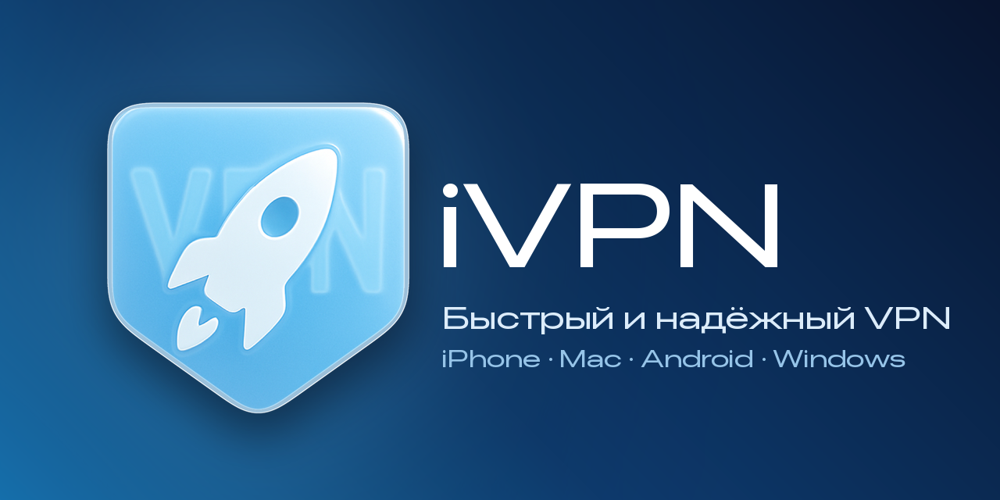

**iVPN** — VPN-клиент для iPhone, iPad, Mac, Android и Windows. Вход по ссылке подписки, без аккаунта и пароля. Подключение в одно нажатие, ядро Xray (VLESS + Reality).

**[app.iapps.sbs](https://app.iapps.sbs)** — сайт приложения: скачать, документация, ответы на частые вопросы.

| Платформа | Где скачать |
|---|---|
| iPhone и iPad (iOS 15+) | [TestFlight](https://testflight.apple.com/join/4CWpp5Pg) |
| Mac (macOS 13+) | [TestFlight](https://testflight.apple.com/join/4CWpp5Pg) |
| Android 7.0+ | [`iVPN-<версия>.apk`](https://github.com/ivpn-plus/ivpn/releases/latest) |
| Windows 10 и 11 | [`iVPN-Setup-<версия>.exe`](https://github.com/ivpn-plus/ivpn/releases/latest) |

Что умеет приложение:
- **«Держать в сети».** Когда оператор включает белые списки, приложение само переходит на сервер, который отвечает, и возвращает ваш, когда ограничения снимают.
- **Авто и быстрый пинг.** Самый быстрый сервер выбирается сам; пинг всех серверов — за пару секунд, честно через VPN.
- **Несколько подписок.** Срок, трафик и контакт поддержки приходят с сервера подписки.
- **Сайты и приложения мимо VPN.** Российские сервисы — напрямую по встроенному списку; свои исключения — в настройках.
- **Блокировщик рекламы** — по желанию.
- **Логи в поддержку в одно касание** — без пересылки файлов вручную.
- **Виджеты, Live Activity и Пункт управления** на iPhone; Liquid Glass на iOS 26 и macOS 26.
- **Журнал сети и проверка утечек** IP и DNS.

Идеи и ошибки — [bug.iapps.sbs](https://bug.iapps.sbs) · Новости — [@ivpn_channel](https://t.me/ivpn_channel) · [Политика конфиденциальности](https://app.iapps.sbs/privacy/)
